<p align="center">
  
</p>

<h1 align="center">Carbon Gap</h1>

<p align="center"><b>The fact-checker of carbon.</b><br>
What countries and companies <b>declare</b> they emit, versus what independent data <b>observes</b>, priced at the cost of carbon.</p>

<p align="center">
  <a href="docs/media/carbon-gap-demo.mp4"><b>▶ Watch the 2:40 demo</b></a> ·
  Built for the <b>OpenAI Paris DevDay Community Hackathon</b> (24–25 Oct 2026) · Tracks: <b>Impact</b> (climate action) + <b>Build in public</b>
</p>

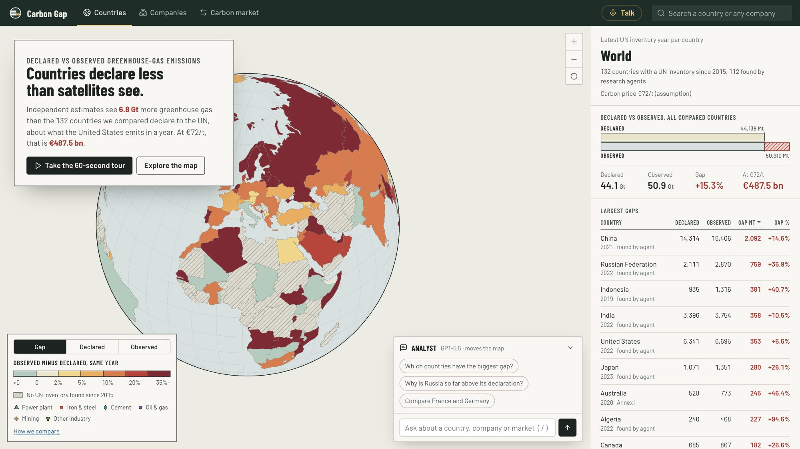

---

## The problem

Carbon has a price: EU allowances trade around €70–85 per tonne, the EU's carbon border tax (CBAM) started in 2026, and countries trade emission reductions under the Paris Agreement. Hundreds of billions of euros depend on emission figures.

Yet those figures are **self-declared**: computed from averages and emission factors, reported to the UN years late, sometimes not at all. Meanwhile, satellites and asset-level models (Climate TRACE) now estimate emissions plant by plant. Nobody puts the two side by side, at scale, and turns the difference into something a journalist, an NGO, an investor or a regulator can act on.

## What Carbon Gap does

Carbon Gap reconciles **declared** emissions (UN inventories, company reports) with **observed** emissions (Climate TRACE), same year, same scope, and turns every gap into a **sourced lead to investigate**, valued in euros.

> Across the 132 countries we compare, independent estimates see **6.8 Gt more greenhouse gas than declared to the UN, about what the United States emits in a year** (≈ €488 bn at €72/t).
>
> **Coal India** reports 26.7 Mt of Scope 1 emissions. Its own tracked mines emit **66 Mt** (Climate TRACE, mostly coal-mine methane).

A gap is never presented as proof of misreporting: methods, boundaries and years differ. It is a lead, with its sources, its confidence and the sites behind it.

### Who it is for

| User | What they do with it |
|---|---|
| **Climate journalists & NGOs** | Find and source a story in minutes: which country or company, which sites, which documents. |
| **EU importers under CBAM** | Check the real emissions of their suppliers' plants instead of trusting declarations or paying default values. |
| **Buyers of Paris Agreement credits (Article 6)** | Check that a selling country does not under-report. |
| **ESG investors, banks** | Spot greenwashing and carbon risk before investing. |
| **Regulators, verifiers** | Prioritise inspections where the gap is largest. |

---

## Features

### 1. The gap, country by country
Every country is coloured by observed minus declared emissions for the same year. Hatched countries have no recent declaration. Switch to declared or observed totals in one click.

| | |
|---|---|
| 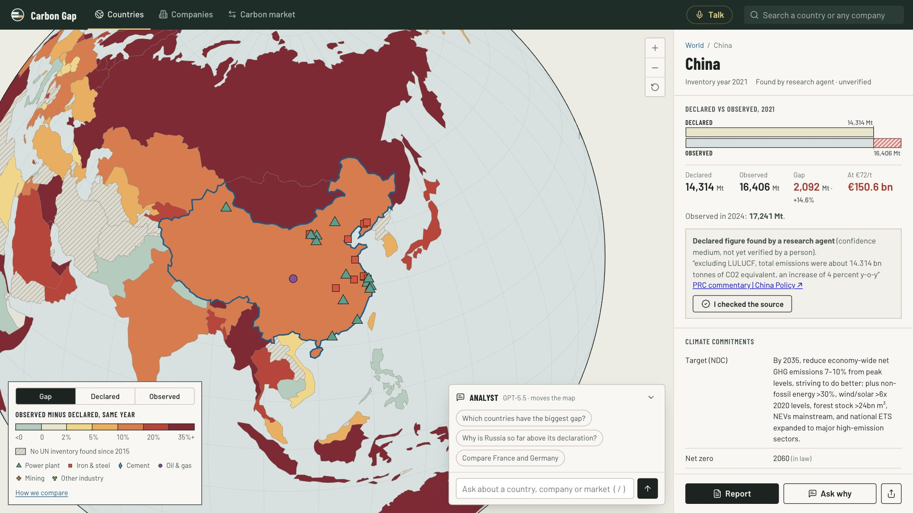 | 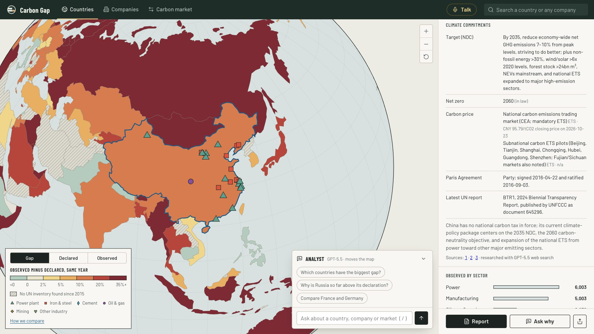 |
| **Country sheet**: declared vs observed with the gap hatched, value in euros, inventory sectors, observed sectors, largest sites, sources. | **Climate commitments** for 112 countries: NDC target, net-zero year and legal status, carbon taxes and ETS prices, Paris status, latest UN report. Researched with GPT-5.5 + web search. |

### 2. Every large site, seen from space
8,154 power plants, steel mills, cement works, refineries and mines in 215 countries. Click one to see it from space, with its owner, emissions and confidence.

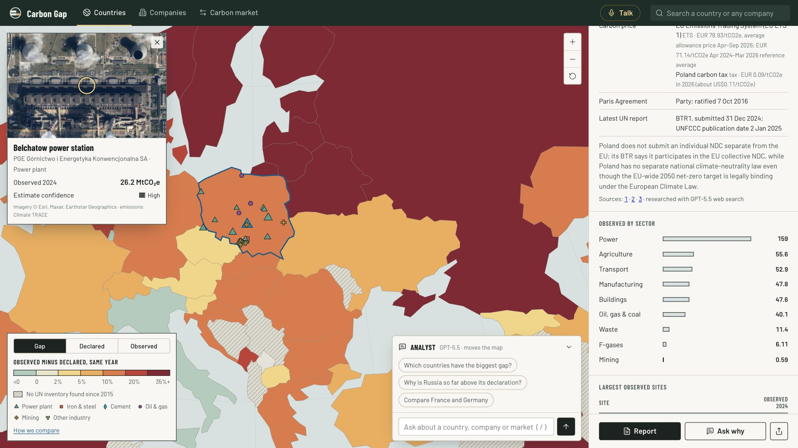

### 3. An analyst that moves the map
Ask anything, in any language. The analyst (GPT-5.5, function calling) reads Carbon Gap's data, searches the web and a curated knowledge base, cites its sources, and **drives the globe while it answers**: flies to countries, highlights them, opens companies, focuses sites, switches views, launches agents.

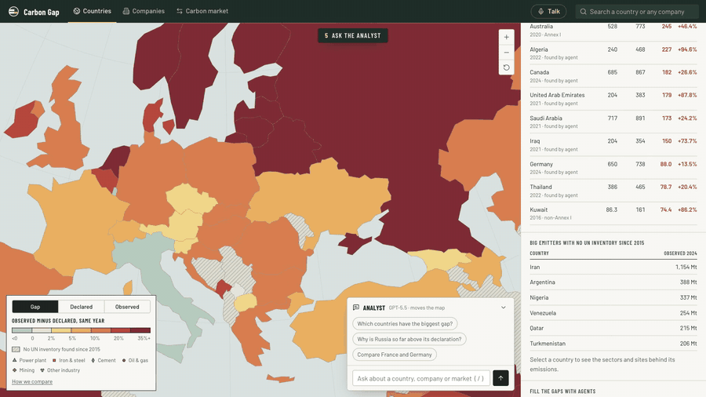

### 4. One-click sourced dossiers, with a spoken briefing
A full investigation dossier per country, written with Structured Outputs (strict JSON schema) and web search: headline, findings, sectors, sites to investigate, next steps, caveats, sources. Read aloud by `gpt-4o-mini-tts`. Export to PDF.

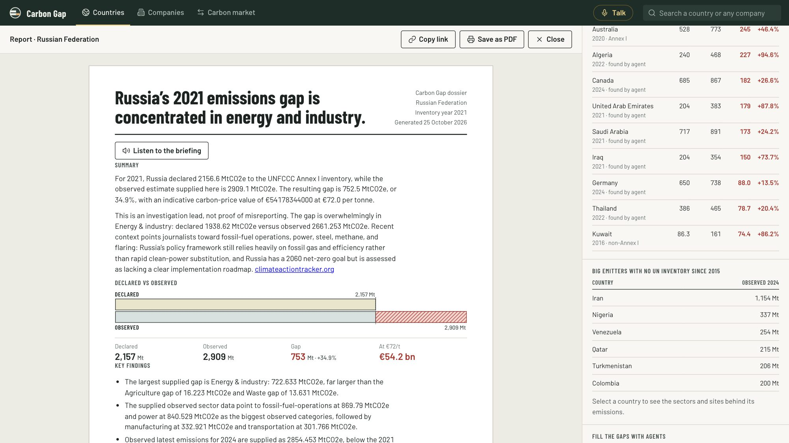

### 5. Companies: what they report vs what their sites emit
144 of the world's largest emitting groups. Their sites tracked by Climate TRACE (subsidiaries grouped under parents by GPT-5.5) versus the Scope 1 they report themselves, found in their reports by an agent with the exact quote. **Type any company in the world** and an agent profiles it live.

| | |
|---|---|
| 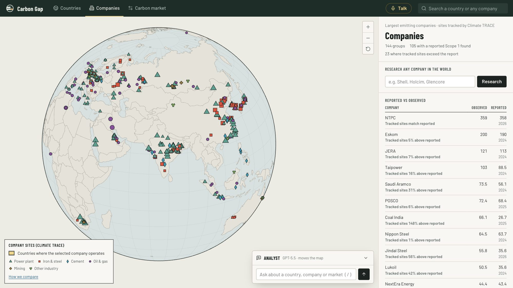 | 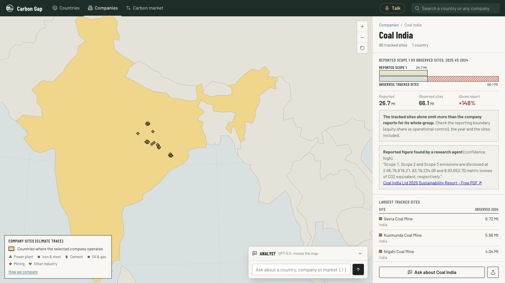 |

### 6. A swarm of research agents
Missing data? Launch agents in parallel, visible on the globe. Each one reads official reports (Biennial Transparency Reports, national inventories), extracts the figure, and **must quote it verbatim from its source**, or the figure is rejected. Countries recolour as declarations are found.

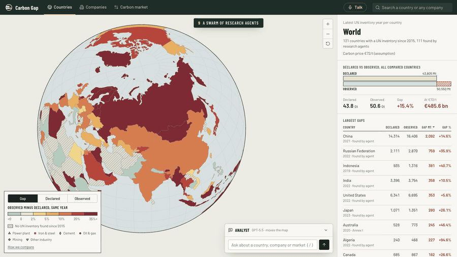

### 7. The EU carbon market
EU ETS verified emissions vs free allowances for 29 countries and 6 sectors since 2013: who must buy allowances, who has a surplus. Poland's plants must buy 76 Mt a year, while its steel and cement sectors receive more free allowances than they emit.

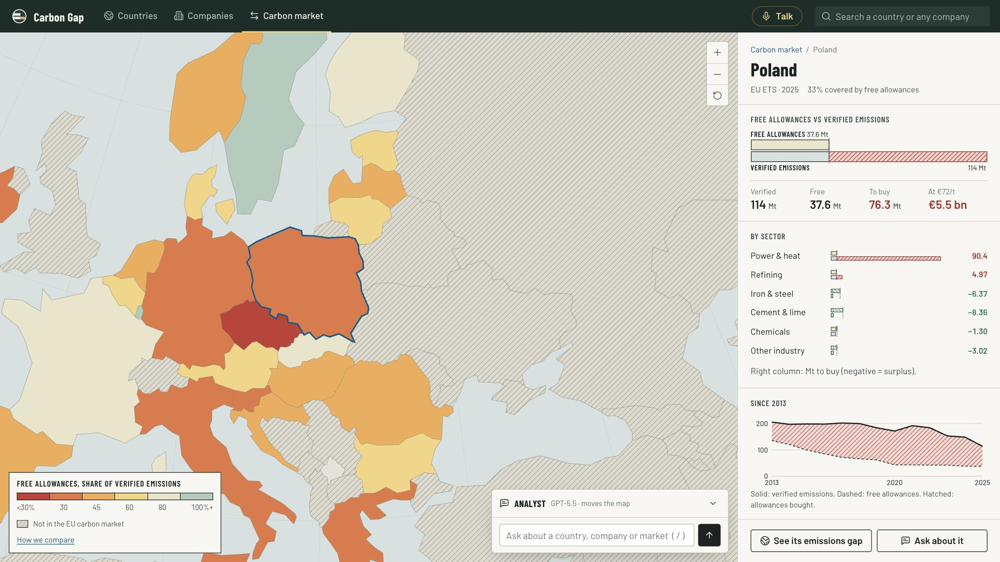

### 8. Talk to it
Press **Talk** and ask out loud. `gpt-4o-transcribe` listens, the analyst answers in two spoken sentences while the map moves, ElevenLabs speaks. Then it listens again: a real conversation.

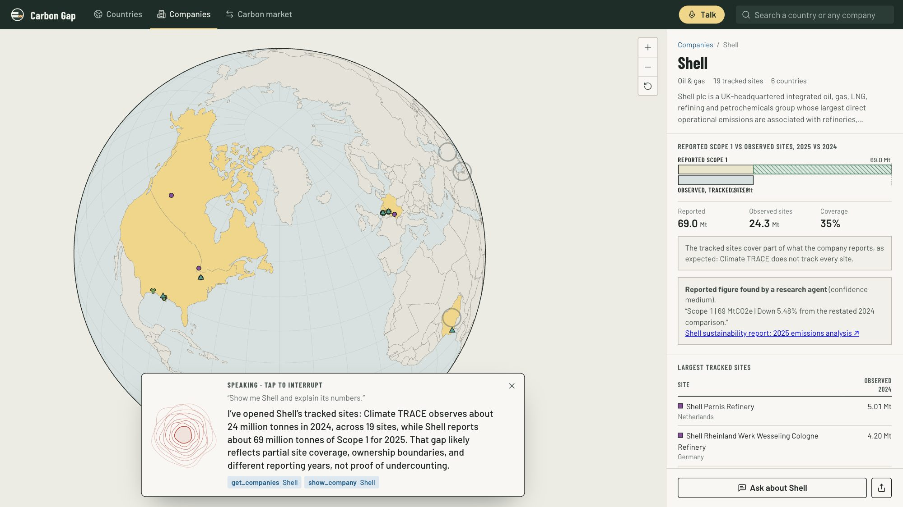

### 9. Share a finding
Every country or company finding becomes a ready-to-post card for X.

<p align="center">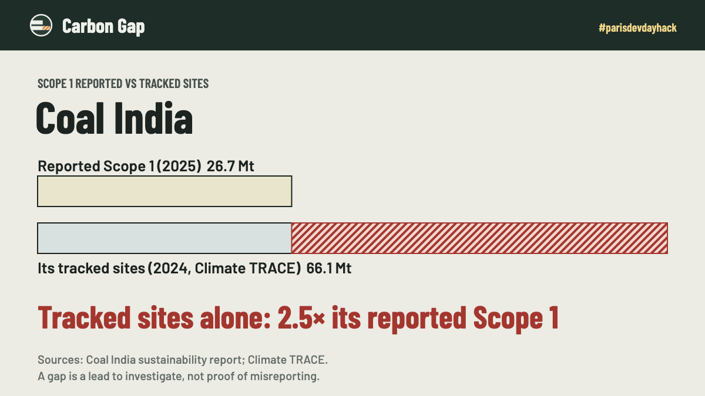</p>

### And more
A 60-second guided tour for first-time visitors, unified search (countries and any company), human verification of agent figures ("I checked the source"), a methodology page, deep links.

---

## Built on the OpenAI API, end to end

We used the OpenAI platform for every intelligent part of the product.

| Where | OpenAI feature | Model |
|---|---|---|
| Analyst: reads data, moves the map, launches agents (16 function tools + 2 built-in tools) | **Responses API**, **function calling** (strict), **streaming**, conversation state with `previous_response_id` | `gpt-5.5` |
| Recent context in answers and dossiers | **Built-in `web_search`** with URL citations | `gpt-5.5` |
| Knowledge base: reporting rules, carbon markets, CBAM, national targets, how to read a gap | **`file_search`** over a **vector store** | `gpt-5.5` |
| Country research agents (declarations in official reports) | **Structured Outputs** (strict JSON schema) + second pass with **`web_search`** | `gpt-5.5` |
| Company research agents (self-reported Scope 1) | **Structured Outputs** + **`web_search`** | `gpt-5.5` |
| Discover any company (subsidiaries, facility countries, sectors) | **`web_search`** + **Structured Outputs** | `gpt-5.5` |
| Grouping 5,900 Climate TRACE owners under parent companies | **Structured Outputs** | `gpt-5.5` |
| Climate policy profiles of 112 countries | **`web_search`** + **Structured Outputs** | `gpt-5.5` |
| Investigation dossiers | **Structured Outputs** + **`web_search`** | `gpt-5.5` |
| Spoken report briefings | **Text-to-speech** | `gpt-4o-mini-tts` |
| Voice input | **Speech-to-text** | `gpt-4o-transcribe` |

Agents run in parallel (`asyncio`), with automatic retries on rate limits. Also used: **Keenable** (web search and page reading for agents), **ElevenLabs** (spoken answers in voice mode, film voiceover), **Postgres on Aiven** (agent results).

### Guardrails against invented numbers
- **Quote check**: every figure found by an agent must come with a verbatim quote that is found again in the cited page. Otherwise it is rejected.
- **No second-hand social sources**: LinkedIn, X, Reddit, etc. are refused.
- **Plausibility**: a declared total far from the observed one (unit or scope errors, e.g. kilotonnes read as megatonnes) is rejected automatically.
- **Human in the loop**: every agent figure is labelled "found by agent, unverified" until a person clicks "I checked the source".
- **Honest framing**: the analyst is instructed to call a gap a lead, explain likely methodological causes, and never claim fraud.

---

## The data

| | Source | Coverage |
|---|---|---|
| Declared, countries | UNFCCC inventories via the [Climate Watch API](https://www.climatewatchdata.org/) + newer reports (Biennial Transparency Reports, national inventory reports) found by agents | **132 countries compared**, 112 declarations found or updated by agents, all 236 countries researched |
| Observed | [Climate TRACE](https://climatetrace.org/) API v6, country and asset level, same year as the declaration, all sectors except forestry | all countries, 8,154 large sites cached |
| Companies | Climate TRACE assets by owner + self-reported Scope 1 found by agents | **144 groups, 105 with a reported Scope 1** |
| Carbon market | EEA EU ETS Union Registry data via [datahub.io](https://github.com/datasets/eu-emissions-trading-system) | 29 countries, 2013–2025 |
| Climate policies | Researched by GPT-5.5 with web search, sources kept | 112 countries |
| Carbon price | €72/t, an assumption close to recent EU prices (not live) | |

Read the in-app **"How we compare"** page for the methodology and its limits (methane estimates, emission factors, GWP versions, reporting years, partial site coverage for companies).

---

## Architecture

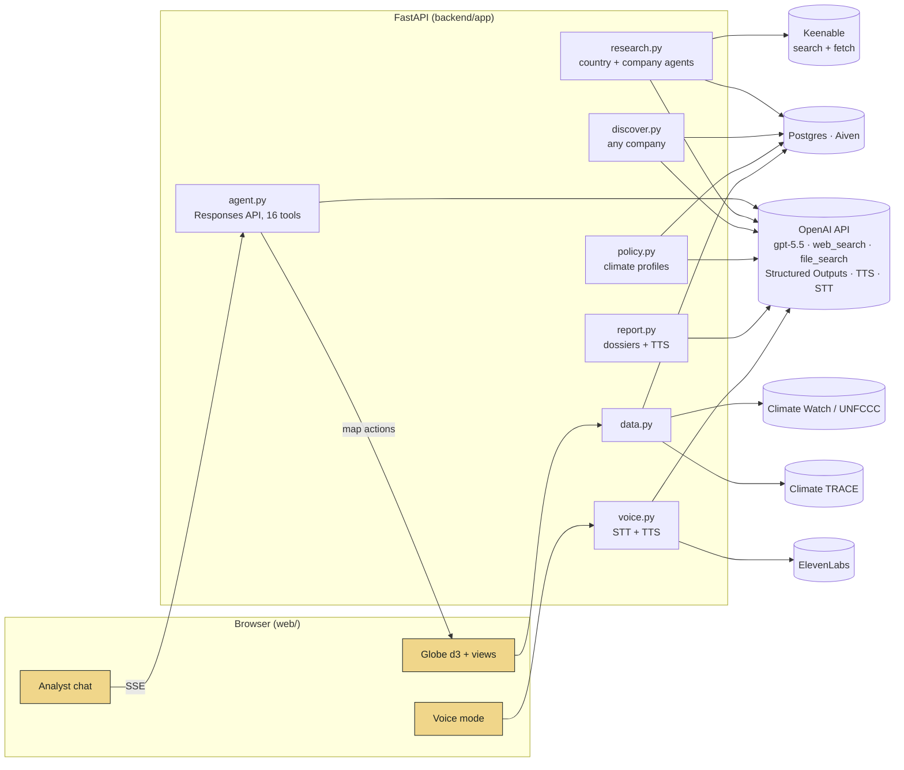

```
web/                    front-end: index.html, style.css, app.js (globe, views, analyst), voice.js
backend/app/main.py     FastAPI routes, SSE streams, static hosting
backend/app/agent.py    the analyst: Responses API, tools, web_search, file_search
backend/app/research.py research agents (countries, companies), swarm, guardrails
backend/app/discover.py discover any company
backend/app/policy.py   country climate profiles
backend/app/report.py   dossiers (Structured Outputs) + spoken briefing
backend/app/voice.py    transcription + streamed voice
backend/app/store.py    Postgres store (with a committed snapshot fallback)
backend/scripts/        data builds, bulk research, snapshot export, smoke test
knowledge/              knowledge base indexed in an OpenAI vector store
video/                  scripted recording of the demo film
```

---

## Built this weekend

| When | What |
|---|---|
| **Sat morning** | Idea, product brief, clickable mockup with synthetic data, motion film for X |
| **Sat afternoon** | Real data (UNFCCC vs Climate TRACE, same year), GPT-5.5 analyst with map tools and web search, structured dossiers with spoken briefings |
| **Sat night** | Research agents with quote checks, knowledge base (file_search), Postgres, voice mode, EU carbon market view |
| **Sun morning** | Companies (owners grouped by GPT), company agents, new identity, "research any company", simpler interface with guided tour |
| **Sun afternoon** | Satellite views, visible agent swarm, share cards, bulk research of every country and 144 companies, climate profiles, guardrails, demo film |

Methodology feedback from a master's student in sustainability science.

---

## Run it locally

```bash
cd backend
uv venv --python 3.12 .venv && uv pip install -p .venv/bin/python -r requirements.txt
cp .env.example .env    # OPENAI_API_KEY (required for AI), ELEVENLABS_API_KEY, KEENABLE_API_KEY, DATABASE_URL (optional)
.venv/bin/uvicorn app.main:app --port 8010
```

Open http://localhost:8010. Without a database, the app loads the committed snapshot of all agent results (`backend/data/snapshot.json`). Without keys, the data views still work.

```bash
.venv/bin/python -m scripts.smoke_test                # end-to-end API checks
.venv/bin/python -m scripts.research_all 5            # research every country without a declaration
.venv/bin/python -m scripts.discover_companies --more # discover more companies
.venv/bin/python -m scripts.research_policies 110 3   # climate profiles
.venv/bin/python -m scripts.export_snapshot           # save agent results into the repo
```

---

<p align="center"><b>Carbon has a price. It deserved a check.</b><br>
<sub>Built by @ISMMO0 · #parisdevdayhack · data: Climate TRACE, UNFCCC / Climate Watch, EEA · imagery © Esri</sub></p>
